# ORRERY: the manual

ORRERY is a small band in one module: strings, a lead, a bass, drums and a box of background effects, with an echo
and a reverb around them. You pick a scene, press PLAY, and play the lead over it. Everything in a scene can be
changed, and this manual says where.

Every picture here is the module's own screen, taken in the emulator.

- [Start in a minute](#start-in-a-minute)
- [The panel](#the-panel)
- [Where do I change it?](#where-do-i-change-it) (the quick answer to most questions)
- [Scenes](#scenes)
- [Playing](#playing)
- The sounds: [strings](#strings-edit), [lead](#lead-glo), [bass](#bass-env), [drums](#drums-lfo), [chords](#chords-seq)
- Your own notes: [the step sequencer](#steps-seq-twice) and [the song](#song-seq-three-times)
- The effects: [mix](#mix-fx), [parts](#parts-fx-twice), [effect sequence](#effect-sequence-fx-three-times),
  [echo and hall](#echo-and-hall-fx-four-times), [sweep and phasers](#fx-held-the-sweep-and-the-phasers)
- [Saving](#saving)
- [MIDI and the SMK-37's pads](#midi-and-the-smk-37s-pads)
- [Lists](#lists): every sound, rhythm, hall and pattern
- [What it cannot do](#what-it-cannot-do)

## Start in a minute

1. Open fm1-dock's list with **HOME** (from a module that has its own panel, hold it about two seconds), turn
   **PRESETS** to ORRERY and press **HOME** again.
2. Turn **PRESETS** to a scene. A banner names it for two seconds.
3. Press **PLAY**. The scene plays by itself.
4. Play the keys: on most pages they are the lead. **OCT−** and **OCT+** move them an octave.
5. Press **FX** for the mix: KNOB1..4 are the levels of the strings, the lead, the bass and the drums.

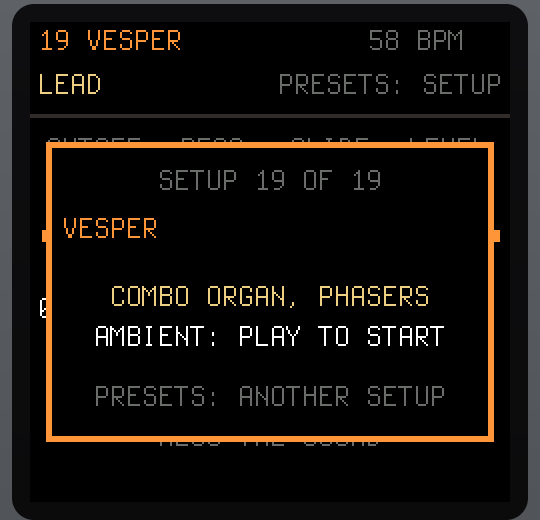

## The panel

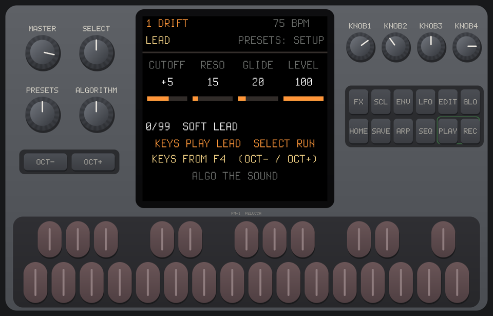

The screen's top line is the scene and its tempo (RUN while it plays). The second line is the page you are on. Under
that are the four knobs' names and values, and the bottom lines say what SELECT, ALGORITHM and the keys do on that
page: read them, they change with the page.

| Control | What it does |
| --- | --- |
| **EDIT**, **GLO**, **ENV**, **LFO** | open the STRINGS, LEAD, BASS and DRUMS pages |
| **SEQ** | CHORDS, then round: STEPS (your own sequences) and SONG (their order) |
| **FX** | the effect pages, round: MIX, PARTS, FX SEQ, ECHO. Held, it is a shift key (see [FX held](#fx-held-the-sweep-and-the-phasers)) |
| **KNOB1..4** | the four values named on the screen |
| **ALGORITHM** | the page's main choice: usually which sound |
| **SELECT** | the page's second choice (a run, a sequence, a hall ...) |
| **PRESETS** | the scene, on every page |
| **PLAY** | start and stop |
| **SEL** | on a sound's page (and FX SEQ), solo that part; again brings everyone back. On PARTS it has another job |
| **ARP** | all notes off. On STEPS it writes a rest; on FX SEQ it has another job |
| **REC** | LATCH: the keys set chords instead of playing (see [chords](#chords-seq)) |
| **OCT−**, **OCT+** | the keys' octave. On DRUMS they are the rhythm lever |
| **SAVE** | save every scene now (see [saving](#saving)) |
| **HOME** held (a second and a half) | back to fm1-dock's list |

## Where do I change it?

| I want to change ... | Go to | Turn |
| --- | --- | --- |
| which scene plays | any page | PRESETS |
| how loud a part is | FX (MIX) | KNOB1 strings, KNOB2 lead, KNOB3 bass, KNOB4 drums |
| how loud the effects box or the wind is | FX twice (PARTS) | KNOB3 box, KNOB1 wind |
| the tempo | ENV (BASS) or LFO (DRUMS) | KNOB3 on BASS, KNOB1 on DRUMS |
| the lead's sound | GLO (LEAD) | ALGORITHM |
| the strings' sound | EDIT (STRINGS) | ALGORITHM |
| the bass's sound, or its line | ENV (BASS) | ALGORITHM the sound, SELECT the line |
| the rhythm | LFO (DRUMS) | ALGORITHM, or press a white key (hold one, press another: both) |
| a chord | SEQ (CHORDS) | SELECT the chord, KNOB1 its root, KNOB2 its kind |
| how much reverb | FX (MIX) | ALGORITHM. The lead's own: ALGORITHM on PARTS |
| which hall | FX four times (ECHO) | SELECT |
| the echo's time | FX four times (ECHO) | ALGORITHM (OFF to switch it off) |
| how much echo a part gets | FX four times (ECHO) | KNOB3 strings, KNOB4 lead |
| the strings' phaser | EDIT (STRINGS) | KNOB4 |
| a phaser on the lead or the effects box | any page | hold FX, KNOB3 the lead's, KNOB4 the box's |
| a filter sweep over everything | any page | hold FX, KNOB1 (KNOB2 its resonance) |
| what plays by itself in the background | FX twice (PARTS) | the SEL button, round |
| which background effects play, and when | FX three times (FX SEQ) | ALGORITHM a ready pattern, or edit events |
| a run of notes from each key | GLO (LEAD) | SELECT |
| a melody or riff of my own | SEQ twice (STEPS) | press the keys, one note a step; KNOB4 switches it on |
| the order my sequences play in | SEQ three times (SONG) | SELECT a slot, KNOB1 its sequence |

## Scenes

A scene is a whole setting: the key and chords, every sound, the rhythm, the levels, the echo and the hall. There are
nineteen. **PRESETS** goes round them on any page.

Scenes are of two kinds, and the kind is fixed for each:

- **AMBIENT** scenes play eight chords, two bars each, over a held bass. Nothing drives them, so they suit slow
  playing. The wind and the background parts belong to these.
- **BAND** scenes play a bass line from the ARP 2600's sequencer with a chord on each of its links, and a rhythm.

| | Scene | Kind | What you hear |
| --- | --- | --- | --- |
| 1 | DRIFT | ambient | phased strings over a far Bossa Nova, droplets |
| 2 | PULSE | band | strings, the root-and-octave bass, Rock 1, a 2600 lead |
| 3 | HELIX | band | a huge ensemble pad, no drums |
| 4 | OCTAVES | band | bright violins, Rock 3 |
| 5 | MAGNET | band | a C minor pulse, Rumba |
| 6 | LASER | ambient | the laser harp playing a phrase, a vast hall |
| 7 | TIDES | ambient | a glass choir, the sea, gulls |
| 8 | NEON | ambient | a brass that swells, night rain, thunder |
| 9 | DAWN | ambient | a major key, vibes, birds |
| 10 | RAIN | ambient | a breath choir, droplets |
| 11 | CAVERN | ambient | a deep drone, far metal |
| 12 | BREATH | band | a bass line with rests, full strings, phaser |
| 13 | STORM | ambient | thunder, rain, a slow swell |
| 14 | ORBIT | ambient | bleeps, sweeps, far calls |
| 15 | COMET | band | an arpeggio, shots, Rock 4 |
| 16 | ICE | ambient | open fifths, chimes, wind |
| 17 | TEMPLE | ambient | five notes, a pan flute, a gong |
| 18 | PRISM | ambient | the harmonic pluck, bubbles, phasers |
| 19 | VESPER | ambient | a combo organ through its phaser |

What you change in a scene stays with it while the unit is on. See [saving](#saving) for keeping it.

## Playing

What the keys play depends on the page:

| Page | The keys |
| --- | --- |
| LEAD, MIX, ECHO | the lead |
| STRINGS, CHORDS | the strings |
| BASS | the bass |
| DRUMS | not notes: the white keys choose a rhythm (see [drums](#drums-lfo)) |
| PARTS | the effects box: runs and single sounds (see [parts](#parts-fx-twice)) |
| FX SEQ | set the note of the event under the cursor |
| STEPS | write the note at the cursor (and play it) |
| SONG | the lead |

- **OCT−** and **OCT+** move the keys an octave; the LEAD page says where they start (KEYS FROM F4).
- **SEL** solos the part of the page you are on; the top of the screen says SOLO and its name. **SEL** again ends it.
- **ARP** stops every note.
- MIDI notes from outside always play the lead.

## Strings (EDIT)

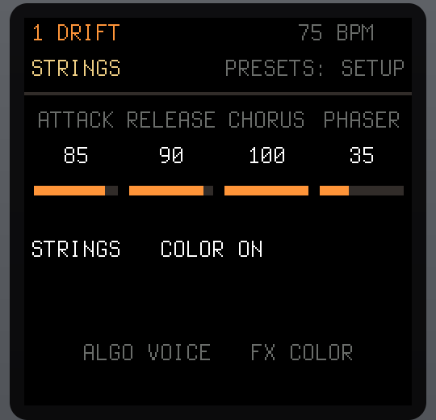

| Control | |
| --- | --- |
| ALGORITHM | the voice: four registrations of the string machine (STRINGS, CELLO, VIOLIN, FULL), then fourteen pads |
| KNOB1 | ATTACK: how slowly a chord comes in |
| KNOB2 | RELEASE: how long it rings after |
| KNOB3 | CHORUS: the ensemble effect's depth (0 is OFF) |
| KNOB4 | PHASER: the strings' own phaser (0 is OFF) |

The screen also shows COLOR ON. That is the phaser's colour switch; it cannot be changed from the panel in this
version (the screen's FX COLOR hint is left over).

With a pad chosen the knobs are the pad's own: ATTACK, RELEASE, DEPTH and TONE.

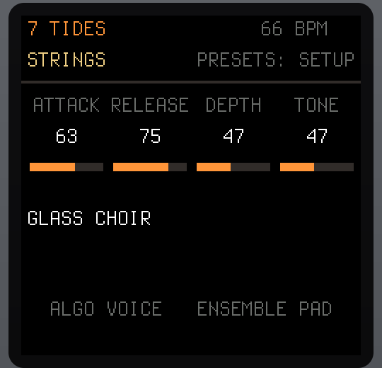

The strings' octave and level are on the [CHORDS](#chords-seq) page (KNOB3 and KNOB4), and the level is also KNOB1 on
MIX.

## Lead (GLO)

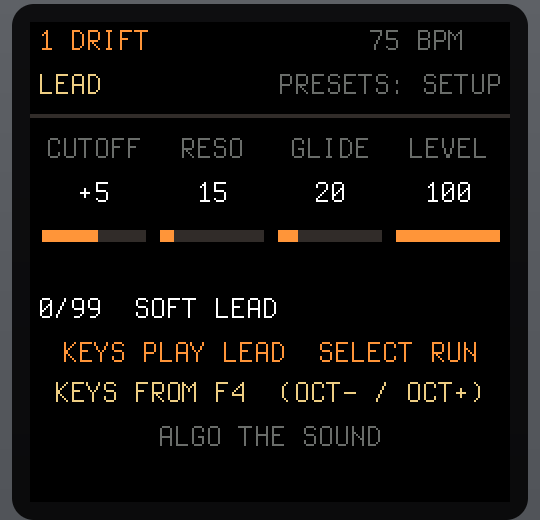

| Control | |
| --- | --- |
| ALGORITHM | the sound: one of a hundred, numbered on the screen (0/99 SOFT LEAD) |
| SELECT | the run: OFF, or a rise of notes from each key you press |
| KNOB1 | CUTOFF: darker or brighter than the sound's own |
| KNOB2 | RESO: the filter's resonance |
| KNOB3 | GLIDE: how slowly it slides from note to note |
| KNOB4 | LEVEL |

The hundred sounds are four instruments in one list (all named in [the lists](#the-lead-sounds)):

- **0 SOFT LEAD** and **2 .. 11**: the ARP 2600. CUTOFF, RESO and GLIDE work on these.
- **1 LASER HARP** and **12 .. 90**: the Synthex's own sounds. They take only LEVEL: the other three knobs do nothing.
- **91 .. 99**: the harmonic voice (plucks, bells, pipes, a combo organ). Also LEVEL only.

**The run.** With SELECT off OFF, a key plays a rise from itself, two octaves up, and holds the top note while you
hold the key. PENTA uses the chord's five-note scale, SCALE its whole scale, CHORD only the chord's notes. FAST is a
quick sweep; 1/16 keeps time with the tempo.

A phaser for the lead is on [FX held](#fx-held-the-sweep-and-the-phasers), its echo on [ECHO](#echo-and-hall-fx-four-times)
(or KNOB4 on PARTS), its reverb on [PARTS](#parts-fx-twice) (ALGORITHM).

## Bass (ENV)

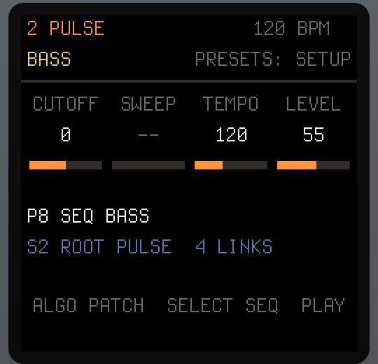

| Control | |
| --- | --- |
| ALGORITHM | the sound: ten ARP 2600 patches (P1 .. P10) |
| SELECT | the line it plays: eight sequences (S1 .. S8). BAND scenes only. A sequence brings its own tempo |
| KNOB1 | CUTOFF |
| KNOB2 | SWEEP: shown as "--". It does nothing in this version |
| KNOB3 | TEMPO, 40 .. 240, for the whole scene |
| KNOB4 | LEVEL |

In an AMBIENT scene the bass holds the chord's root and there is no line to choose; the keys play it on this page.

## Drums (LFO)

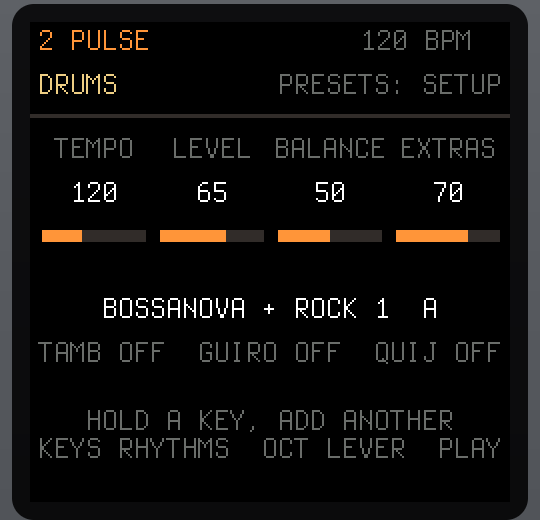

| Control | |
| --- | --- |
| ALGORITHM | one of the twenty rhythms |
| the white keys | the first ten from the left each choose a rhythm; the lit key again means no rhythm. **Hold one and press another: both play together** |
| OCT−, OCT+ | the lever: A or B. Each white key has a rhythm for each |
| F#, G#, A# (the first three black keys) | tambourine, guiro and quijada on and off |
| KNOB1 | TEMPO |
| KNOB2 | LEVEL |
| KNOB3 | BALANCE: from the dark drums to the bright ones |
| KNOB4 | EXTRAS: the level of the tambourine, guiro and quijada |

**Two rhythms at once.** Hold a rhythm's key and press another: the two play together, their hits on the same drum
voices, as when two keys of the machine this is after are held down (the trick those records used). More keys add
the same way. A key pressed by itself goes back to one rhythm. Both keys take the lever's side, A or B. The rhythms
by key are in [the lists](#the-rhythms).

## Chords (SEQ)

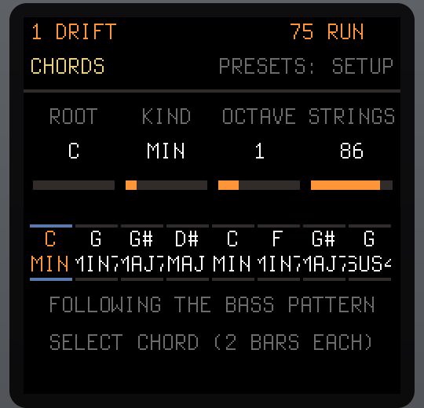

The row of boxes is the scene's chords. The one playing is lit while the scene runs.

| Control | |
| --- | --- |
| SELECT (or ALGORITHM) | move to a chord |
| KNOB1 | ROOT: its note |
| KNOB2 | KIND: none, MIN, MAJ, MIN7, MAJ7, SUS2, SUS4, 5TH |
| KNOB3 | OCTAVE: the strings' octave, 0 .. 4 |
| KNOB4 | STRINGS: their level |
| REC | LATCH: while it is lit, pressing a key sets the chosen chord's root (a minor chord if there was none) |

An AMBIENT scene plays all eight, two bars each. A BAND scene plays as many as its bass sequence has links (two or
four); the rest are grey.

## Steps (SEQ twice)

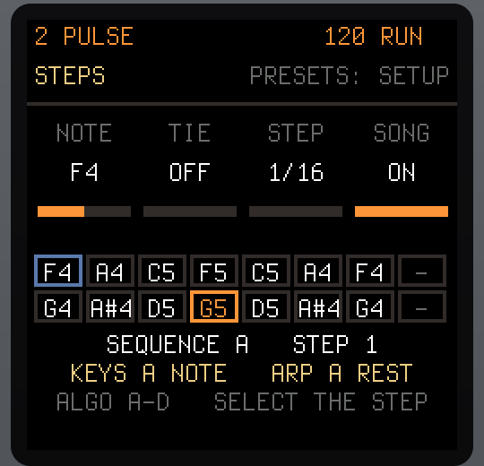

This is a step sequencer for your own notes. Each scene has four sequences, **A to D**, of sixteen steps each. They
play on the lead's sound, in time with the scene, and you can still play the keys over them.

**To write one:** press the keys. Each key writes its note at the blue box and moves on to the next step; **ARP**
writes a rest. Then turn **KNOB4** to ON and press **PLAY**. The orange box is the step playing.

| Control | |
| --- | --- |
| the keys | write a note at the cursor and move on (you hear it) |
| ARP | write a rest and move on |
| SELECT | move the cursor to a step |
| ALGORITHM | which sequence: A, B, C or D |
| KNOB1 | NOTE: the step's note, a semitone a click |
| KNOB2 | TIE: joined to the step before. The same note is held on (shown as =); another note is slid to |
| KNOB3 | STEP: how long a step is, for this sequence: 1/16 (the sequence is one bar), 1/8 (two bars) or 1/4 (four) |
| KNOB4 | SONG: ON and the sequences play; OFF and the lead is yours alone |

Turning SONG on for the first time puts the sequence you are on into the song, so one sequence simply loops. In an
AMBIENT scene your sequences take the place of the lead's own phrase.

The sequence plays whatever the lead's sound is: choose it on the [LEAD](#lead-glo) page. A sound that plays one
note at a time (the ARP 2600's) is shared between the sequence and your keys; the Synthex's and the harmonic voice's
play both.

## Song (SEQ three times)

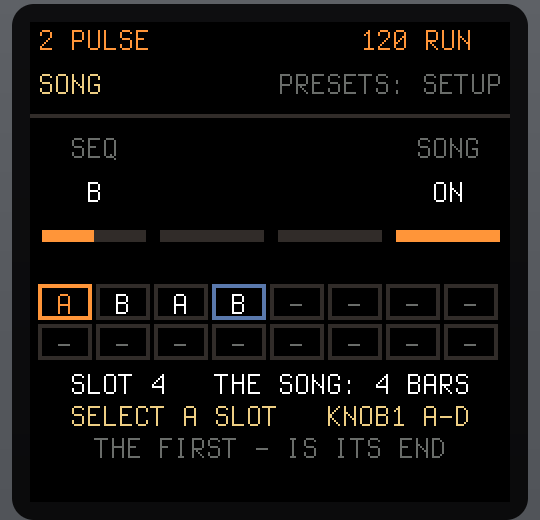

The song is the order your sequences play in: up to sixteen slots, each one sequence played through once, then round
again from the first.

| Control | |
| --- | --- |
| SELECT | move to a slot |
| KNOB1 (or ALGORITHM) | the slot's sequence: A, B, C, D, or "-" |
| KNOB4 | SONG on and off, as on STEPS |

The first "-" is the song's end: what comes after it is not played. The screen says how many bars the song is, and
the orange box is the slot playing. A slot lasts as long as its sequence (one, two or four bars), and a change of
sequence always lands on a bar line.

## Mix (FX)

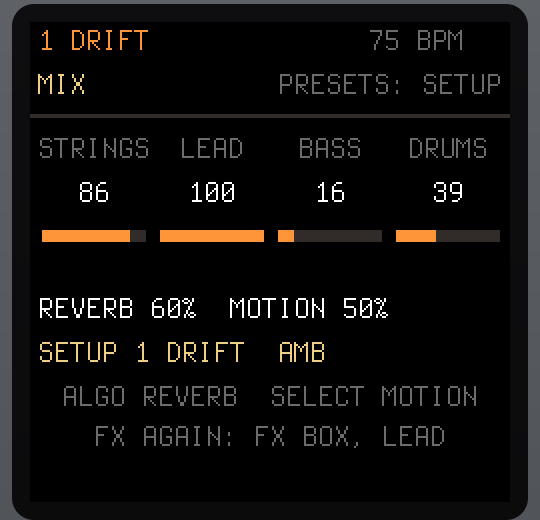

| Control | |
| --- | --- |
| KNOB1..4 | the levels of the strings, the lead, the bass and the drums |
| ALGORITHM | REVERB: how much of the strings (and a band's parts) goes to the hall |
| SELECT | MOTION: how far the slow filter sweeps move the sound by themselves |

If the screen says CLIPPING, lower the levels.

## Parts (FX twice)

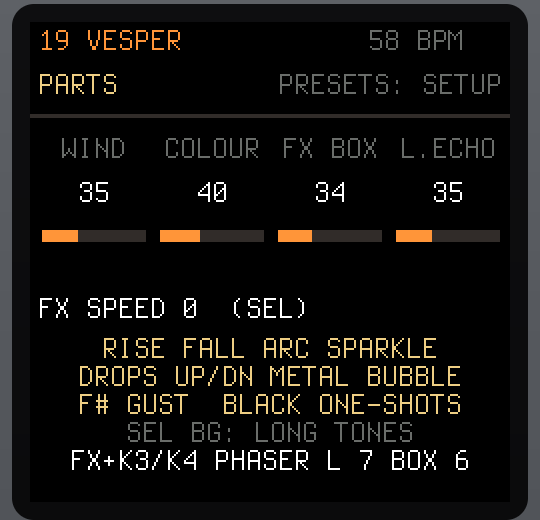

This page is the background: the wind and the effects box.

| Control | |
| --- | --- |
| KNOB1 | WIND: its level. It blows while an AMBIENT scene plays |
| KNOB2 | COLOUR: the wind from low to high |
| KNOB3 | FX BOX: the level of the box's sounds |
| KNOB4 | L.ECHO: how much of the lead goes to the echo |
| ALGORITHM | the lead's own reverb. (The screen does not show its value) |
| SELECT | FX SPEED: how fast the runs below go, −4 slow .. +4 fast |
| SEL button | the background, round: nothing, the box's run up each chord, the lead's own phrase (HARP, LONG TONES, BELLS, CALLS), or run and phrase together. AMBIENT scenes only. It stops the scene: press PLAY again |

The last line shows the two phasers (see [FX held](#fx-held-the-sweep-and-the-phasers)).

**The keys play the effects box here.**

- The white keys, from the lowest: RISE, FALL, ARC (up and back), SPARKLE, DROPS UP, DROPS DOWN, METAL FALL, BUBBLE
  RISE, then the same again higher. Each is a run through the chord's scale from that key.
- The first F#: a gust of wind while you hold it.
- The other black keys: one sound each, round: DROP, PING, BUBBLE, CHIRP, METAL, ZAP, WHISTLE, GULL, TWITTER, BLEEPS,
  WHOOSH, SURF, THUNDER.

## Effect sequence (FX three times)

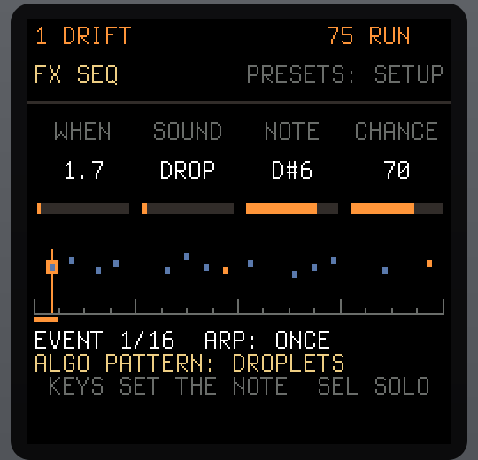

This is what the effects box plays by itself: up to sixteen events over sixteen bars (eight in a BAND scene). The
line across the screen is the time; each mark is an event, higher for a higher note, in its sound's colour.

The quick way: **ALGORITHM** picks a ready pattern (DROPLETS, RAIN, BIRDS, STORM ... all in [the lists](#the-effect-patterns)).
It says YOURS once you change an event.

To edit an event:

| Control | |
| --- | --- |
| SELECT | move to an event (1 .. 16). You hear it as you land on it |
| KNOB1 | WHEN: bar and eighth (1.7 is bar 1, the seventh eighth) |
| KNOB2 | SOUND: none ("--", a free slot) or one of the thirteen |
| KNOB3 | NOTE. A key sets it too |
| KNOB4 | CHANCE: how often it plays, in percent |
| ARP | how it is played: ONCE, or as a run UP, DOWN, ARC or SPARKLE |
| SEL | solo the effects box, to hear only this |

If the page says FX BOX LEVEL IS 0, raise KNOB3 on PARTS.

## Echo and hall (FX four times)

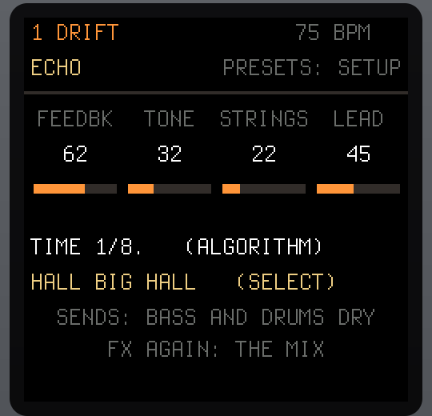

| Control | |
| --- | --- |
| ALGORITHM | TIME: OFF, 1/16, 1/8, dotted 1/8, 1/4, dotted 1/4, 1/2 of the tempo |
| SELECT | HALL: the reverb's room, ROOM to ENDLESS |
| KNOB1 | FEEDBK: how many repeats |
| KNOB2 | TONE: dark repeats to bright |
| KNOB3 | STRINGS: how much of the strings goes to the echo |
| KNOB4 | LEAD: how much of the lead |

The bass and the drums never go to the echo.

## FX held: the sweep and the phasers

Hold **FX** and turn a knob, on any page. (If you turn nothing, letting go changes the page as usual.)

| With FX held | |
| --- | --- |
| KNOB1 | a low-pass filter over everything: turn it down to close. The top of the screen says SWEEP |
| KNOB2 | that filter's resonance |
| KNOB3 | the lead's phaser, 0 (off) .. 10 |
| KNOB4 | the effects box's phaser, 0 (off) .. 10 |

The PARTS page shows the two phaser values on its last line. The strings have their own phaser on the STRINGS page.

## Saving

- **The scene you are in is kept by itself**, with its sequences and song. Two seconds after any change the module
  stores where you are, so the unit comes back as you left it.
- **Changes to the other scenes last until power-off** unless you press **SAVE**, which stores all nineteen, each
  with its sequences.
- There is no way on the panel to get a factory scene back once you have saved over it.

## MIDI and the SMK-37's pads

| MIDI | |
| --- | --- |
| notes (any channel but the pads') | the lead |
| program change 0 .. 99 | the lead's sound, by its number |
| CC 7 | the lead's level |
| CC 74 | the lead's cutoff |
| CC 70, 71, 72, 73 | the levels of the strings, the bass, the drums, the effects box |
| CC 1 (mod wheel) | closes the filter over everything |
| CC 64 (pedal) | holds the lead |
| CC 120, 123 | all notes off |

The sixteen pads are channel 10, notes 36 .. 51:

| Pad | |
| --- | --- |
| 1 .. 5 | mute and unmute the bass, the lead, the strings, the drums, the effects box |
| 6 | everyone back (mutes and solo off) |
| 7 | the next scene |
| 8 | PLAY and stop |
| 9 .. 13 | the effects box's DROP, PING, BUBBLE, CHIRP, METAL, as hard as you hit |
| 14 | a gust of wind while held |
| 15, 16 | two glass bells |

## Lists

### The lead sounds

| Number | Sound | Instrument |
| --- | --- | --- |
| 0 | SOFT LEAD | ARP 2600 |
| 1 | LASER HARP | Synthex |
| 2 .. 11 | WARM BASS, PLUCK SEQ, GLASS PLUCK, ARP LEAD, LASER SYNC, S&H SPACE, PERCUSSIVE, SEQ BASS, SUB BASS, TWIN SAWS | ARP 2600 |
| 12 .. 90 | the Synthex's factory sounds, below | Synthex |
| 91 .. 99 | HARMONIC PLUCK, HOLLOW PLUCK, GLASS BELLS, PIPES, BRIGHT REED, SOFT FLUTE, OCTAVE CHIME, NASAL LEAD, COMBO ORGAN | harmonic voice |

The Synthex's (the screen shows the first fifteen letters, in capitals):

| | | | |
| --- | --- | --- | --- |
| 12 Chunky Synth | 13 Wah brass | 14 Fat Sound | 15 Metallic |
| 16 Pan flutes | 17 Tremolo piano | 18 Chorale | 19 Brass I |
| 20 Brass II | 21 Brass III | 22 Double basses | 23 Ceilos |
| 24 Violins | 25 Church organ | 26 Reed organ | 27 Electronic organ |
| 28 High pass sweep | 29 Filtered brass | 30 Filtered chorus | 31 Filtered strings |
| 32 Metallic piano | 33 Pianet | 34 Funky Clav. | 35 Clavichord I |
| 36 Clavichord II | 37 Clavinet | 38 Electric piano I | 39 Electric piano II |
| 40 Chimes | 41 Vibes | 42 Sweep 1 | 43 Sweep 2 |
| 44 Take-off | 45 Landing | 46 Wash of sound | 47 Fast decay |
| 48 Phased sweep | 49 Bass pluck | 50 Whistle | 51 Cathedral choir |
| 52 Sync. Harmonic Sweep | 53 Filtered Choir | 54 Harsh Clavinet | 55 Echo |
| 56 Double Bass - Nylon Guitar | 57 Sync. 1 | 58 Sync. 2 | 59 De-tuned pipe organ |
| 60 Normal Clavinet | 61 Harsh lead | 62 Solo Violin | 63 Bass Guitar |
| 64 Sync. 3 | 65 Glide Strings | 66 Hammond 1 (John Lord) | 67 Phased Choir |
| 68 Brash Brass | 69 Brushed Cymbals | 70 Hammond 2 (Emerson) | 71 Plink |
| 72 Wah Ring Mod. | 73 Metallic Clavinet | 74 Bass Drum - tom-toms | 75 Hammond 3 (Brooker T) |
| 76 Plucked brass | 77 Snare Drum | 78 Distant Strings | 79 Watery Grave |
| 80 High Portamento | 81 Electric Piano | 82 Oriental Fourths | 83 Wood Blocks |
| 84 Marimba | 85 Harp | 86 Filtered brass | 87 Deep. Sync. |
| 88 Mini Moog Bass | 89 Mini Moog Lead | 90 Steel Drums |  |

### The strings' voices

STRINGS, CELLO, VIOLIN, FULL (the string machine), then the pads: VINTAGE STRINGS, GLASS CHOIR, DUSK ORCHESTRA,
ABYSS PAD, PROFILE A, STRING MACHINE, BREATH CHOIR, DEEP DRONE, GLASS SHIMMER, SLOW SWELL, ROUGH PULSE, SOLO DRIFT,
HUGE ENSEMBLE, RUNNING PAD.

### The bass

Sounds P1 .. P10: WARM BASS, PLUCK SEQ, GLASS PLUCK, ARP LEAD, LASER SYNC, S&H SPACE, PERCUSSIVE, SEQ BASS, SUB BASS,
TWIN SAWS.

| Sequence | Links | Its tempo |
| --- | --- | --- |
| S1 E MIN ARP | 4 | 128 |
| S2 ROOT PULSE | 4 | 120 |
| S3 OCTAVE ECHO | 4 | 130 |
| S4 C MIN PULSE | 4 | 138 |
| S5 BREATHING | 2 | 112 |
| S6 SLOW TIES | 2 | 96 |
| S7 OCTAVE JAB | 4 | 124 |
| S8 UP AND DOWN | 4 | 134 |

### The rhythms

The ten white keys from the left, with the lever at A and at B:

| Key | Lever A | Lever B |
| --- | --- | --- |
| 1 | Waltz | Jazz Waltz |
| 2 | Samba | Meringue |
| 3 | Mambo | Cha-cha |
| 4 | Rumba | Beguine |
| 5 | Tango | Habanera |
| 6 | Bossanova | Slow Rock |
| 7 | Rock 1 | Rock 2 |
| 8 | Rock 3 | Rock 4 |
| 9 | March 2/4 | March 6/8 |
| 10 | Swing | Latin Swing |

### The halls

ROOM, PLATE, HALL, BIG HALL, DARK HALL, CATHEDRAL, VAST, ENDLESS.

### The effects box's sounds

DROP, PING, BUBBLE, CHIRP, METAL, ZAP, WHISTLE, GULL, TWITTER, BLEEPS, WHOOSH, SURF, THUNDER.

### The effect patterns

EMPTY, DROPLETS, SPARSE, RAIN, BELLS, BUBBLES, SIGNALS, CAVERN, SHORE, STORM, BIRDS, COMPUTER, LASERS, SPACE, SCALES,
CASCADES, CITY, FROST, GONGS.

## What it cannot do

- **Sequence more than one part.** Your sequences play the lead's sound. The bass keeps its eight built-in lines
  and the drums their rhythms.
- **Follow the chords.** A sequence plays the notes you wrote, whatever chord is sounding.
- **A song across scenes.** The song chains sequences inside one scene; changing scene still stops and restarts.
- **Record what you play.** Notes go in a step at a time.
- **The bass's SWEEP knob** and **the strings' COLOR switch** are shown but do nothing yet.
- **A factory reset** of a saved scene.
- **Editing the harmonic voice's or the Synthex's sounds.** You choose one; only its level changes.
